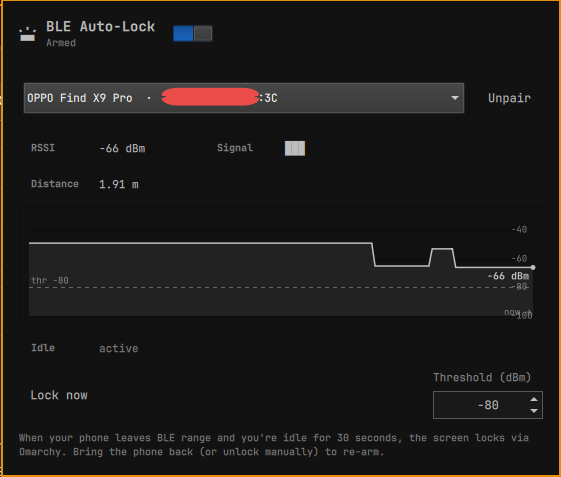

# bleguard

I kept walking away from my desk for ten minutes and coming back to find my laptop unlocked and the dog asleep on the keyboard. The screen lock from the idle service is fine when I leave it on the desk; I wanted something stricter — "if my phone isn't next to the laptop, lock". This is a small Omarchy plugin that watches the BLE link to a paired phone, waits for a 30 s input idle, and locks via `omarchy-system-lock`. With the optional unlock patch installed, it also unlocks itself when the phone comes back, no password.



## what it does

Polls `org.bluez.Device1.RSSI` and `AdvertisingFlags` over D-Bus every 2 s for the phone you picked in the popup, plus the Wayland `ext-idle-notify-v1` seat-idle counter (30 s threshold).

The plugin considers the phone "lost" when any of:

- BR/EDR ACL is up but the RSSI is fresh and below the threshold (default −64 dBm), or
- BR/EDR ACL is up but no RSSI has ever been observed (ColorOS paired+trusted quirk — see [quirks](#quirks)), or
- BR/EDR ACL is up but the RSSI hasn't been observed for `rssiStaleWindowMs` (30 s), or
- BR/EDR ACL is down, no BLE advertisement has been received for `rssiStaleWindowMs`, or
- BR/EDR ACL is down, an advertisement was received recently, but the RSSI (when fresh) is below the threshold.

If you become idle while the phone is "lost", the screen locks via `omarchy-system-lock`. If the phone comes back into range with `autoLockSource=true` (only locks this plugin triggered), the plugin drops the session lock without PAM after `unlockStableMs` (10 s) of stable presence.

State machine: `DISARMED → ARMED → WARNING → WAITING → LOCKING → LOCKED → UNLOCKING → ARMED`. Manual unlock routes `LOCKED → ARMED` directly; auto-unlock routes through `UNLOCKING`. State (target MAC, armed flag, threshold) persists in `~/.local/state/omarchy/bleguard-state.json` so it survives shell restarts.

## requirements

- Omarchy shell. `omarchy`, `omarchy-shell`, `omarchy bar move` on `$PATH`.
- `bluez` — `sudo systemctl enable --now bluetooth` if it isn't already running.
- `busctl` (from `systemd`) — used to read `org.bluez.Device1.RSSI` and `AdvertisingFlags`. Ships with `systemd` on Arch.
- `jq` — only required if you use `./install.sh --enable` (the script edits `shell.json` for you).
- `omarchy-system-lock` on `$PATH` — installed by Omarchy by default. The plugin will *not* fall back to `hyprlock` / `swaylock` / `loginctl lock-session` because none of those give you the Omarchy lock UI.

## install

```
git clone https://github.com/for1337/bleguard.git
cd bleguard
./install.sh --enable
```

`install.sh` symlinks `bleguard/` into `~/.config/omarchy/plugins/`, adds the plugin to `~/.config/omarchy/shell.json`, and asks Omarchy to place the bar widget in the right section. Re-run with `--force` if a previous install left a real folder at the target. `uninstall.sh` is the inverse (`--purge` also deletes the state file).

For the auto-unlock on return (optional):

```
sudo bash patches/install-lock-unlock-ipc.sh   # exposes an `unlock` IPC on the lock plugin
```

Idempotent; re-run to no-op. Revert with `--revert`.

Reload the shell so the new code loads:

```
omarchy restart shell
```

## using it

Click the bar widget — first launch shows the device picker (only currently-paired BLE devices). Pick your phone. From then on the bar icon shows the state: shield (armed), warning (phone out), lock (locked), shield-off (disarmed). The popup has:

- an `armed` toggle
- current RSSI value and a signal-bar indicator
- a rolling RSSI chart (last 5 minutes)
- a `Threshold (dBm)` field (default −64, range −100..−30) that becomes the new lock boundary the moment you change it
- a `Lock now` button for testing

Hand-edit the state file and `omarchy restart shell` — the service hydrates from disk on startup.

IPC:

```
omarchy-shell bleguard.ctrl status                  # JSON: state, rssi, idle, threshold, history, advertising state
omarchy-shell bleguard.ctrl arm
omarchy-shell bleguard.ctrl disarm
omarchy-shell bleguard.ctrl lockNow
omarchy-shell bleguard.ctrl setTarget <MAC>          # programmatic pairing
omarchy-shell bleguard.ctrl setThreshold <dBm>       # e.g. -75
```

Note: `omarchy-shell bleguard status` (without `.ctrl`) is the Omarchy base Panel handler (`show`/`hide`/`toggle`) — `status` lives on the `.ctrl` target.

## quirks

- **RSSI is polled, not pushed.** BlueZ does not emit `PropertiesChanged` for `RSSI`. The plugin shells out to `busctl get-property` every 2 s. Sub-second polling is wasted.
- **Phone must be paired, not just discoverable.** The picker only lists devices the system already knows (`bluetoothctl devices Paired`). If your phone isn't there, pair it first.
- **Paired+trusted phones often stop exposing RSSI in BlueZ.** On ColorOS in particular, after `Paired=1, Bonded=1, Trusted=1`, BlueZ stops tracking fresh RSSI from passive advertisements — the value goes either stale (frozen at one number) or absent (`No such property` over D-Bus). The plugin uses `AdvertisingFlags` as a presence fallback when RSSI is missing, but distance-based threshold checks stop working in this state. Fix is on the phone side: forget the device in Bluetooth settings, drop the long-term key, and re-pair — RSSI returns within seconds of the next scan-window advertisement. If you don't want to repair, the plugin still detects presence correctly but the threshold UI is decorative.
- **Some OPPO / ColorOS phones drop BR/EDR while still broadcasting BLE advertisements.** This is the "fast sleep" pattern. The plugin treats fresh BLE advertisements as presence evidence for both the warning path and the auto-unlock path, so a sleeping phone on the desk won't lock the laptop and will unlock it if it was already locked. `patches/` carries the unlock IPC; without it, the laptop stays locked until you type the password.
- **Auto-unlock bypasses PAM.** When the patch is installed, the plugin can drop the lock UI without a password after `unlockStableMs` of stable presence. Equivalent to macOS / Windows smart-unlock — a relay attacker within BLE range could trigger it. Auto-unlock only fires for locks this plugin triggered (manual locks via `omarchy-system-lock` keybind are left alone). `autoLockSource` is per-lock state.
- **No `hyprlock` / `swaylock` fallback.** Omarchy uses Quickshell's `WlSessionLock`. If you replace that, this plugin's lock call will silently lock you out of the lock UI.
- **Idle threshold is hardcoded to 30 s.** Same grace/abort UX as the built-in idle service, but stricter.

## development

Debug logs:

```
tail -f /run/user/1000/quickshell/by-id/$(ls -t /run/user/1000/quickshell/by-id/ | head -1)/log.qslog | grep -i bleguard
```

Inspect the live signals for the paired phone:

```
busctl get-property org.bluez /org/bluez/hci0/dev_AA_BB_CC_DD_EE_FF org.bluez.Device1 RSSI
busctl get-property org.bluez /org/bluez/hci0/dev_AA_BB_CC_DD_EE_FF org.bluez.Device1 AdvertisingFlags
busctl get-property org.bluez /org/bluez/hci0/dev_AA_BB_CC_DD_EE_FF org.bluez.Device1 Connected
```

Diagnostic dump (also reachable via the popup chart footer):

```
omarchy-shell bleguard.ctrl status | python3 -m json.tool
```

Validate the manifest:

```
omarchy plugin validate bleguard/
```

## license

MIT.
